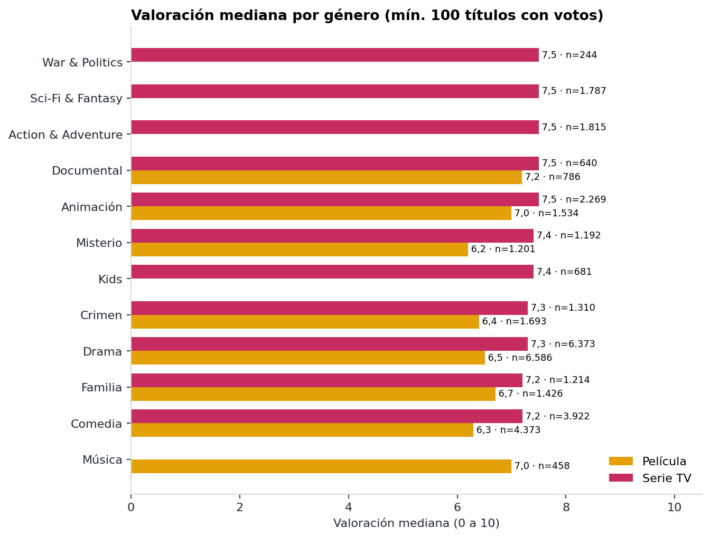
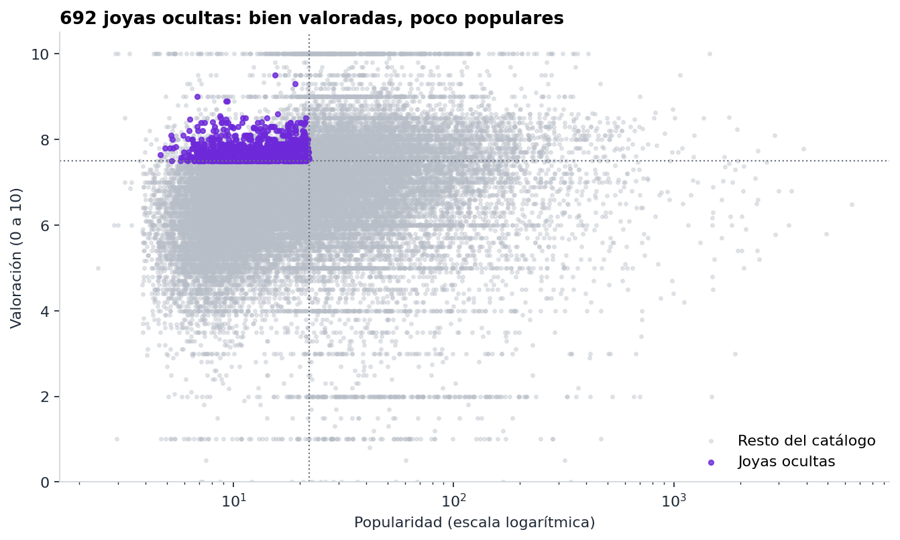
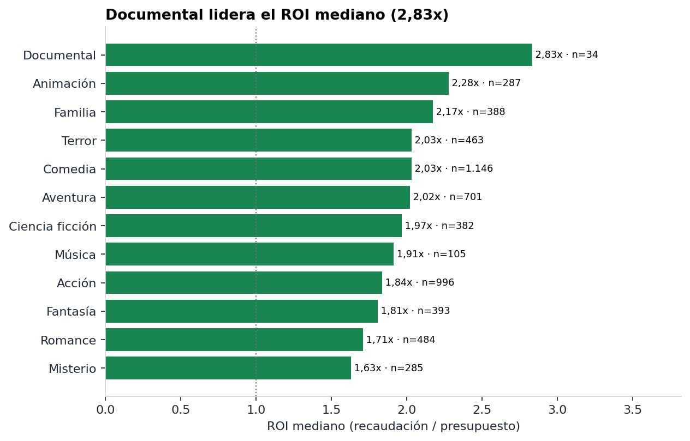

# StreamView Analytics · Visual Analytics del catálogo

**Asignatura:** ADY1104 Visualización de Datos · Duoc UC · Evaluación Parcial EP2
**Equipo:** Lucas Concha, Martín Villarroel y Natalia Hormazábal
**Docente:** Jorge Castro · **Sección:** 002D

> **Resumen.** StreamView tiene un catálogo amplio, pero cada área lo reporta con criterios distintos. Integramos las fuentes en una sola base y construimos un dashboard interactivo pensado para la **Gerencia de Contenidos y Adquisición**. El panel responde tres preguntas: qué tenemos, qué priorizar o destacar y dónde conviene invertir en películas. Este documento explica el problema, los datos, los hallazgos, las decisiones de diseño y las recomendaciones, y cómo ejecutar el proyecto.

## Contenido

1. [Contexto y problema](#1-contexto-y-problema)
2. [Audiencia y pregunta central](#2-audiencia-y-pregunta-central)
3. [Objetivos](#3-objetivos)
4. [Datos e integración](#4-datos-e-integración)
5. [Hallazgos](#5-hallazgos)
6. [Dashboard](#6-dashboard)
7. [Recomendaciones](#7-recomendaciones)
8. [Evaluación crítica](#8-evaluación-crítica)
9. [Estructura del proyecto](#9-estructura-del-proyecto)
10. [Cómo ejecutar](#10-cómo-ejecutar)

---

## 1. Contexto y problema

StreamView Analytics es una plataforma de streaming cuyo catálogo creció gracias a acuerdos con estudios y proveedores externos. La capacidad de analizarlo no creció al mismo ritmo: Marketing, Contenidos y Producto producen reportes con criterios distintos. El resultado son indicadores que no coinciden, reportes que hay que validar a mano y comparaciones difíciles entre géneros, países y formatos.

> El problema no es la falta de datos, sino la falta de una visión única y confiable.

**Alcance real de los datos.** El encargo describe una organización con datos de usuarios, reproducciones y suscripciones. Las fuentes con las que contamos describen el **catálogo** (género, país, idioma, popularidad, valoración) y, solo para una parte de las películas, presupuesto y recaudación. No permiten medir retención ni comportamiento de usuarios. Por eso el proyecto se limita a decisiones sobre el catálogo, y lo declaramos de forma explícita en el dashboard y en este documento.

## 2. Audiencia y pregunta central

Elegimos **una sola audiencia**, la Gerencia de Contenidos y Adquisición. Es el área que decide qué títulos entran, se renuevan o se destacan, y es la que mejor pueden apoyar los datos disponibles.

| Aspecto | Descripción |
|---|---|
| Decisiones que toma | Adquirir contenidos, renovar licencias y series, priorizar géneros y países, definir qué títulos destacar |
| Qué necesita saber | ¿Qué tenemos y qué nos falta? ¿Qué se valora y se ve más? ¿Qué títulos buenos están subutilizados? ¿Qué películas rinden más? |
| Nivel de detalle | Alto: filtra por tipo, género, país y año, y revisa listados de títulos |

**Pregunta central.** ¿Dónde debe concentrar la Gerencia de Contenidos sus próximas adquisiciones y renovaciones, y qué títulos que ya tiene merecen más visibilidad?

Marketing, Producto y Directorio quedan fuera de este alcance. Atenderlos requeriría datos de uso que no tenemos.

## 3. Objetivos

**General.** Diseñar e implementar una solución de Visual Analytics que consolide el catálogo de StreamView en un dashboard interactivo y una narrativa visual que apoyen decisiones de adquisición, renovación y promoción.

**Específicos**

1. Integrar películas, series y datos financieros en una base consistente y documentada.
2. Caracterizar el catálogo por tipo, género, país e idioma.
3. Comparar popularidad y valoración entre formatos, géneros y países.
4. Evaluar la rentabilidad (ROI) de las películas según género y nivel de presupuesto.
5. Identificar títulos bien valorados y poco vistos que se puedan priorizar o destacar.
6. Entregar recomendaciones concretas, priorizadas y respaldadas por la evidencia.

## 4. Datos e integración

### Fuentes

| Archivo | Registros | Contenido |
|---|---|---|
| `data/raw/netflix_movies_detailed_up_to_2025.csv` | 16.000 | Películas (original) |
| `data/raw/netflix_tv_shows_detailed_up_to_2025.csv` | 16.000 | Series (original) |
| `data/processed/netflix_movies_clean.csv` | 16.000 | Películas limpias |
| `data/processed/netflix_tv_clean.csv` | 15.991 | Series limpias, sin duplicados |
| `data/processed/netflix_movies_financial_clean.csv` | 3.540 | Películas con presupuesto y recaudación válidos, más ROI |

Usamos los datasets entregados para el proyecto (archivos `netflix_*`) como representación del catálogo de StreamView.

### Integración

Películas y series se unen en una tabla maestra con la columna `tipo`. Como **397 `show_id` se repiten entre películas y series**, construimos una **llave única `tipo + show_id`**. El subconjunto financiero se enlaza solo con películas mediante esa llave. El proceso está en `src/integracion.py` y genera `master.csv` y `master_financial.csv`, que reproducen exactamente las tablas del repositorio.

### Calidad de datos y tratamiento

| Hallazgo | Tratamiento |
|---|---|
| 9 títulos duplicados en series (18 filas) por `show_id` | Se conserva la primera instancia: quedan 15.991 series |
| Valores nulos en `director`, `cast`, `country` y `genres` | Se rellenan con «Sin Información» o «Sin Género», sin eliminar filas. Estas categorías de relleno se excluyen de los conteos |
| 4.564 títulos con valoración 0, casi todos sin votos | Un 0 sin votos es ausencia de dato, no una nota. La valoración se calcula solo con títulos que tienen votos: la media pasa de 5,69 a **6,63** |
| 11.153 películas con presupuesto 0 y 10.355 con recaudación 0 | Se tratan como dato faltante. El análisis financiero usa solo las **3.540 películas** con ambos valores (22%) |
| ROI con valores extremos | Se usa la **mediana** y no el promedio |
| `duration` 100% nula en películas y `seasons_count` constante en series | Se excluyen del análisis |
| `genres` y `country` con varios valores por título | Se separan y se cuentan por título-categoría |

El detalle del proceso está en `notebooks/Limpieza_DataSet_corregido.ipynb`.

## 5. Hallazgos

Los resultados se ordenan en tres mensajes para la Gerencia de Contenidos. Todas las cifras se recalcularon desde los datos procesados y coinciden con las del dashboard.

**El catálogo.** Tiene **31.991 títulos** (16.000 películas y 15.991 series) de 147 países y 83 idiomas. Está concentrado: el inglés está en el 44% de los títulos y Estados Unidos participa en el 34%. Drama y Comedia lideran el volumen en ambos formatos. Los géneros no son comparables entre tipos, porque cada uno usa su propia clasificación.

**Mensaje 1. Las series son el formato mejor valorado y más popular.**

| | Series | Películas |
|---|---|---|
| Popularidad mediana | 36,2 | 10,9 |
| Valoración media | 7,02 | 6,31 |
| Títulos con nota 7 o más | 62% | 26% |

En los siete géneros que ambos formatos comparten con al menos 100 títulos con votos (Animación, Comedia, Crimen, Documental, Drama, Familia y Misterio), las series tienen mayor valoración mediana. Japón, China y Corea del Sur concentran su catálogo en series (65%, 79% y 60% de sus títulos). Dentro de las series, Japón (7,36) y China (7,26) superan al promedio de 7,02, mientras que Corea del Sur (6,87) queda levemente bajo él.

**Mensaje 2. Popularidad no es calidad.** La correlación entre popularidad y valoración es de apenas **0,05**. Eso deja títulos con calidad escondida, a los que llamamos **joyas ocultas**: valoración de 7,5 o más, al menos 100 votos y popularidad bajo la mediana del catálogo (22,1). Son **692** (632 películas y 60 series). Los países principales con más joyas son Estados Unidos (200), Japón (85), Reino Unido (49) y Corea del Sur (43).

**Mensaje 3. En películas, el retorno depende del género y del presupuesto.**

- El ROI mediano es **1,70x** y el **63%** de las películas recupera su inversión. Es decir, el 37% no la recupera.
- Los géneros con mejor ROI mediano son Animación (2,28x), Familia (2,17x) y Comedia (2,03x). Terror rinde 2,03x, pero tiene la valoración mediana más baja entre las películas (5,8).
- Documental lidera con 2,83x, pero solo tiene 34 películas, por lo que lo interpretamos con cautela.
- Drama, el género más numeroso, tiene un ROI mediano de 1,28x (56% recupera).
- Contra la intuición, el tramo de presupuesto alto (más de 30 M USD) rinde más: ROI de 2,21x y 77% de recuperación, frente a cerca de 1,4x y 57% en los tramos bajo y medio.
- Presupuesto y recaudación se correlacionan en 0,75; presupuesto y valoración, solo en 0,12.

## 6. Dashboard

Construido con **Python, Dash y Plotly**. Tiene tres páginas, y cada una se asocia a una decisión de Contenidos.

| Página | Decisión que facilita | Gráficos |
|---|---|---|
| 1. Panorama del catálogo | ¿Qué tenemos y qué nos falta? | Top 10 géneros por tipo (barras agrupadas) y proporción película/serie por país (barras al 100%, top 10) |
| 2. Calidad y atractivo | ¿Qué priorizar, renovar o destacar? | Popularidad por tipo (caja, escala logarítmica), valoración mediana por género (con n visible), dispersión popularidad vs. valoración con joyas destacadas y tabla ordenable de joyas |
| 3. Rentabilidad de películas | ¿Dónde invertir en películas? | ROI mediano por género (con n), ROI por tramo de presupuesto y presupuesto vs. recaudación (escala log-log con tendencia) |

### KPIs

| KPI | Cálculo |
|---|---|
| Total de títulos | Conteo de `tipo + show_id` únicos |
| Países e idiomas | Valores distintos, sin la categoría de relleno |
| Valoración media | Promedio de `vote_average` solo con `vote_count` > 0 |
| % con nota ≥ 7 | Sobre títulos con votos |
| Popularidad mediana | Mediana de `popularity` (con desglose series y películas) |
| Valoración mediana | Mediana de la valoración de títulos con votos |
| Joyas ocultas | Valoración ≥ 7,5, votos ≥ 100 y popularidad bajo la mediana (con desglose por tipo) |
| ROI mediano | Mediana de recaudación / presupuesto, solo películas |
| % que recupera la inversión | Películas con ROI > 1 |
| Películas con datos financieros | Conteo de películas con presupuesto y recaudación válidos |

### Filtros e interacción

- **Filtros globales:** tipo, género, país y año de estreno, que se aplican a las tres páginas, más un botón para restablecerlos.
- **Clic en una barra** de género o de país filtra el resto del tablero. Un segundo clic en la misma barra quita el filtro.
- **Tabla de joyas ocultas:** se ordena por cualquier columna (valoración, votos, popularidad, país).
- **Página 3:** el filtro de tipo no aplica, porque solo las películas tienen datos financieros. Si se elige «Series», un aviso lo indica.
- Los gráficos de valoración y de ROI por género muestran los 12 mejores géneros (con mínimos de 100 y 30 títulos). Para ver un género específico, como Drama, se usa el filtro de género.

### Por qué elegimos estos gráficos

| Pregunta | Gráfico | Justificación |
|---|---|---|
| ¿Qué tenemos por género? | Barras horizontales agrupadas | La longitud se compara con precisión y las etiquetas largas se leen bien. Se separa por tipo porque las clasificaciones difieren |
| ¿De dónde viene el contenido y qué formato predomina? | Barras apiladas al 100% | Muestra la proporción película/serie sin que el volumen distorsione la comparación |
| ¿Qué formato es más atractivo? | Caja en escala logarítmica | La popularidad es muy asimétrica: la escala log evita que los extremos aplasten la distribución |
| ¿Qué géneros se valoran mejor? | Barras ordenadas con n visible | Ordena de un vistazo y el n evita sobreinterpretar géneros pequeños |
| ¿Qué títulos están subutilizados? | Dispersión con puntos destacados y tabla | La nube muestra que no hay relación, el color aísla las joyas y la tabla entrega los títulos concretos |
| ¿Qué películas rinden más? | Barras ordenadas con n visible | Ordena el retorno por género y advierte de las muestras pequeñas |
| ¿El presupuesto cambia el retorno? | Barras por tramo | Compara tres categorías ordenadas, mostrando ROI, % que recupera y n |
| ¿El presupuesto explica la recaudación? | Dispersión log-log con tendencia | La escala log hace legible un rango de varios órdenes de magnitud |

**Criterios de diseño.** Usamos un código de color consistente (amarillo para películas, fucsia para series, verde para ROI, azul para ingresos y morado para joyas ocultas), títulos que comunican el hallazgo, mediana en lugar de promedio cuando hay asimetría, y notas visibles con las definiciones y límites de cada página.

**Qué dejamos fuera.** El gráfico de crecimiento acumulado, porque hay exactamente 1.000 títulos por año y la línea sería recta por construcción. La matriz de correlación y el gráfico de votos vs. popularidad se conservan en el notebook como análisis exploratorio.

### Figuras del informe

Las figuras estáticas están en `images/` (figuras 1 a 8 y tabla 1) y se regeneran con `src/figuras_estaticas.py`.





## 7. Recomendaciones

Estas cifras salen de datos del catálogo, no de reproducciones reales. Por eso **cada recomendación debe validarse con datos propios de la empresa antes de comprometer inversión**.

| # | Decisión | Evidencia | Cómo se sigue en el panel |
|---|---|---|---|
| 1 | **Destacar y renovar las 692 joyas ocultas**, empezando por las 60 series. Es la decisión de menor riesgo, porque no exige comprar nada nuevo y puede probarse con una promoción medida | Valoración ≥ 7,5, ≥ 100 votos y popularidad bajo la mediana | Página 2: KPI y tabla de joyas |
| 2 | **Reforzar series bien valoradas**, con foco en Japón y China. En Corea del Sur, elegir título a título | Series: 7,02 de valoración media y 62% con nota ≥ 7, frente a 6,31 y 26% en películas. Japón 7,36, China 7,26, Corea del Sur 6,87 | Páginas 1 y 2, con filtros de tipo y país |
| 3 | **En películas, priorizar Animación, Familia y Comedia.** Usar Terror como complemento de retorno y no de calidad, y probar Documental con pocos títulos | ROI de 2,28x, 2,17x y 2,03x. Terror: 2,03x con valoración 5,8. Documental: 2,83x con n = 34 | Página 3, filtro de género |
| 4 | **Definir presupuestos con criterio.** No asumir que lo barato rinde más y ser selectivos con las nuevas adquisiciones de Drama | Tramo alto: 2,21x y 77% recupera. Drama: 1,28x, aunque concentra más joyas (351), por lo que el problema es la selección y no el género | Página 3 y tabla de joyas |

## 8. Evaluación crítica

**Fortalezas**

- Integra tres fuentes con una llave única y un proceso reproducible, ya que los scripts de `src/` regeneran las tablas y las figuras.
- Está diseñado para una sola audiencia, y cada página responde a una decisión concreta.
- Usa indicadores robustos (medianas, exclusión de ceros) y muestra el n sobre el que se calculan.

**Limitaciones**

- Los datos no incluyen comportamiento de usuarios: no se mide retención ni engagement.
- Hay exactamente 1.000 títulos por año y por tipo, y `date_added` coincide con `release_year`, por lo que no se puede analizar la evolución real del catálogo.
- Solo el 22% de las películas tiene datos financieros, lo que puede generar sesgo de selección. Las series no tienen ninguno.
- El ROI no incluye costos de licencia ni de marketing.
- Los géneros de películas y series usan clasificaciones distintas, así que solo se comparan dentro de cada tipo.
- La popularidad es un indicador de la fuente, no reproducciones reales.
- Al enfocarse en la Gerencia de Contenidos, no cubre las necesidades de Marketing ni del Directorio.

**Oportunidades de mejora**

- Incorporar reproducciones, retención y suscripciones propias de StreamView.
- Armonizar la clasificación de géneros entre películas y series.
- Automatizar la actualización de los datos y agregar alertas para adquisiciones.

## 9. Estructura del proyecto

| Carpeta o archivo | Contenido |
|---|---|
| `data/raw/` | Archivos originales |
| `data/processed/` | Archivos limpios (`netflix_*_clean.csv`), tablas maestras (`master.csv`, `master_financial.csv`) y `joyas_ocultas.csv` |
| `notebooks/` | `Limpieza_DataSet_corregido.ipynb`: limpieza y análisis exploratorio |
| `src/` | `integracion.py` (integración con llave única), `metricas.py` (KPIs y tablas) y `figuras_estaticas.py` (figuras del informe) |
| `Dashboard/` | `Dashboard.py`: dashboard interactivo (Dash + Plotly) |
| `images/` | Figuras estáticas 1 a 8 y tabla 1 |
| `requirements.txt` | Dependencias |

## 10. Cómo ejecutar

Requisitos: Python 3.10 o superior.

```bash
pip install -r requirements.txt
python Dashboard/Dashboard.py
```

Luego abrir <http://127.0.0.1:8050> en el navegador. El dashboard resuelve las rutas de los datos por sí mismo, así que puede lanzarse desde cualquier carpeta.

Opcional:

```bash
python src/integracion.py          # regenera data/processed/master*.csv
python src/figuras_estaticas.py    # regenera images/ y data/processed/joyas_ocultas.csv
```

Para rehacer la limpieza desde los datos originales, ejecutar `notebooks/Limpieza_DataSet_corregido.ipynb` (lee `data/raw/` y escribe `data/processed/`). `jupyter` viene incluido en `requirements.txt`.